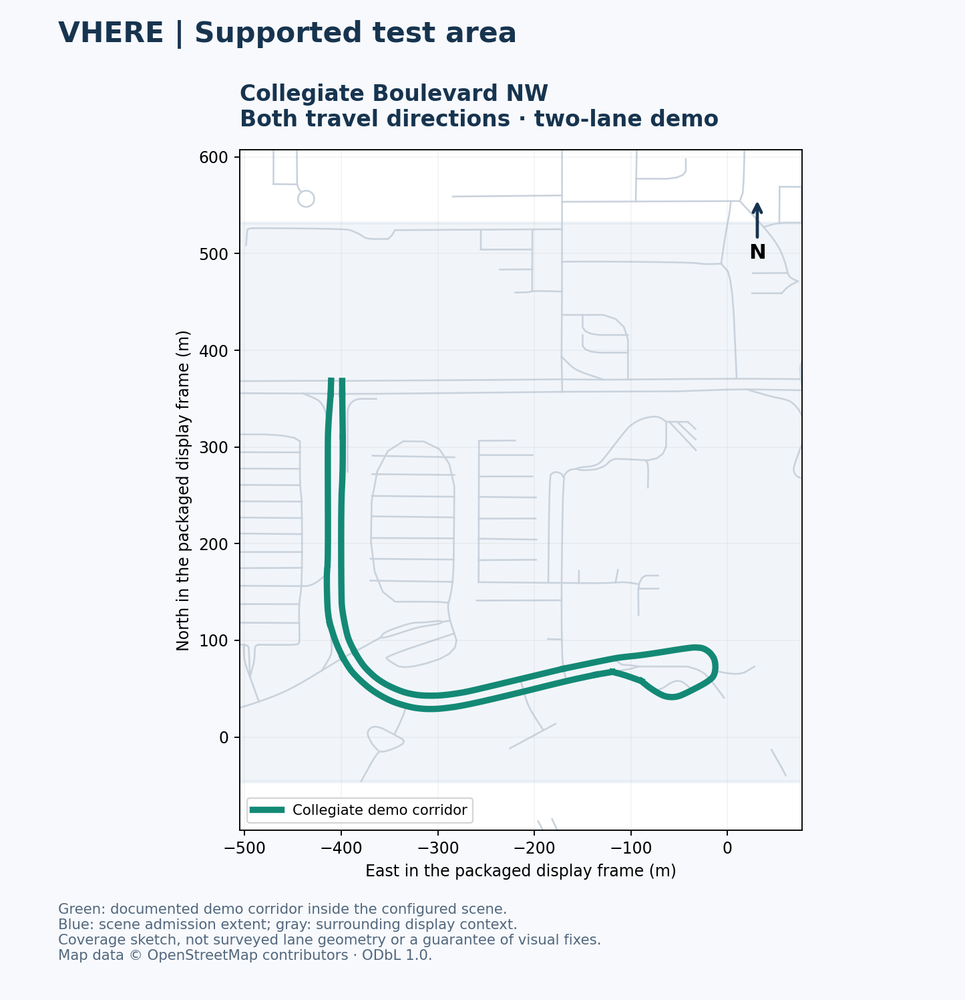
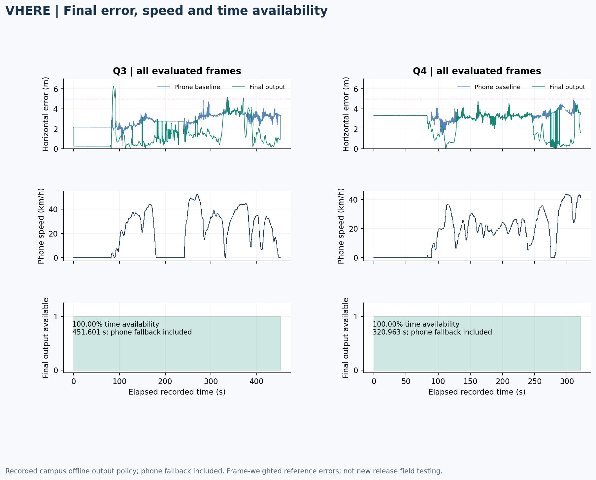
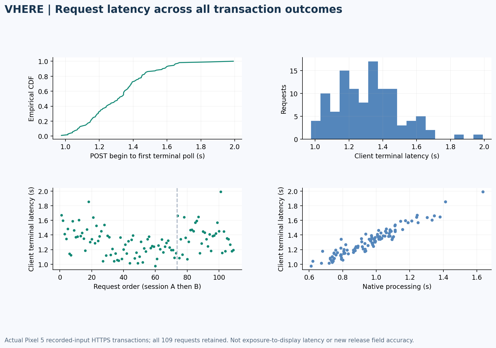
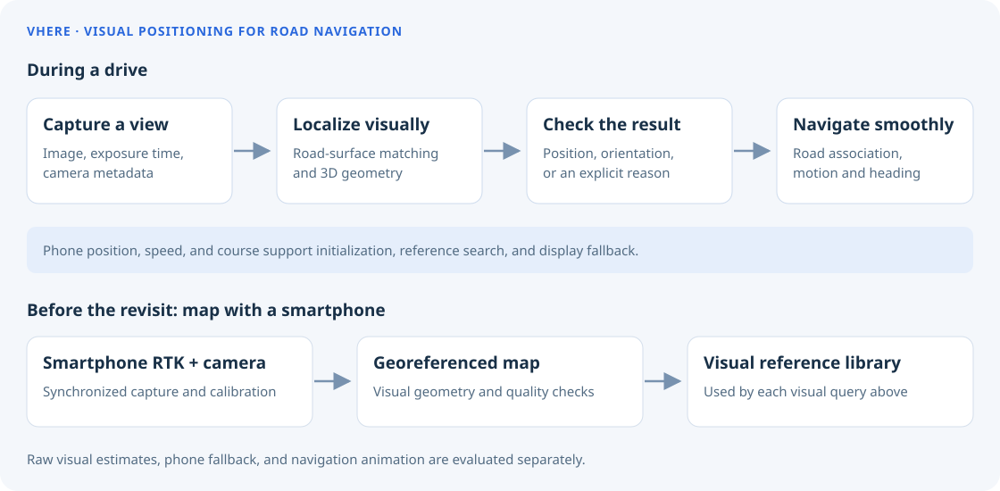
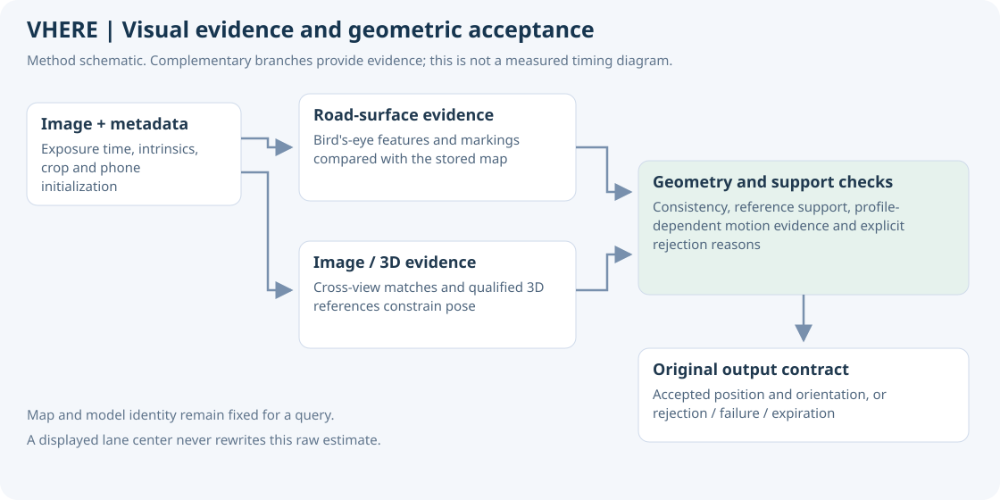

<h1 align="center">VHERE Demo</h1>

<b>Visual positioning for road navigation</b>

Camera positioning, phone-assisted continuity, and a road-aware navigation view.

**Version 0.8.0-demo · October 29, 2026 · Android 10+**

[Download signed APK](https://github.com/YangRiverJiang/vhere-demo/releases/download/v0.8.0-demo/VHERE-demo-0.8.0-release.apk) · [Release and checksums](https://github.com/YangRiverJiang/vhere-demo/releases/tag/v0.8.0-demo) · [User manual](docs/MANUAL.md) · [Results](docs/RESULTS.md)

VHERE matches smartphone camera observations to a prepared visual map and presents a continuous navigation position for vehicles.

## See the navigation experience

Actual Pixel 5 display replay: app on the left, original camera stills on the right. This 12-second, 1× excerpt uses frozen positioning answers from the 0.7.10 display baseline; it is not a new live 0.8.0 accuracy test. Map context contains © OpenStreetMap contributors and City of Calgary data.

## Supported area

The current positioning demo supports **Collegiate Boulevard NW, Calgary, in both travel directions, as a two-lane positioning demo within the prepared scene**. Nearby roads and buildings provide display context. This release does not claim citywide visual coverage, surveyed lane boundaries, or a confirmed lane on every update.

The sketch uses the unchanged packaged road geometry. Visual support can vary inside the scene; a valid phone position remains the fallback. Start within the documented corridor with genuine, fresh phone location.

## Install and connect

1. Download the [signed APK](https://github.com/YangRiverJiang/vhere-demo/releases/download/v0.8.0-demo/VHERE-demo-0.8.0-release.apk) and check its SHA-256 in the Release assets.
2. Install **VHERE Demo**. It uses the separate `com.vhere.demo` identity and can coexist with the older development app without deleting its records.
3. Grant camera and precise foreground location permissions. Keep the app in the foreground.
4. Open `Navigation → Connect`, obtain a private access token from the maintainer, and save it. The service URL and certificate pin are prefilled in this release.
5. Enter the supported corridor, wait for location/service readiness, then enable `Camera`. Use `Stop camera` when finished and export the session if reporting a problem.

Release assets in this private review repository require an authorized GitHub login. The APK contains no service token. Users do not need an RTK receiver for ordinary navigation.

## Service connection

| Setting | Value |
| --- | --- |
| HTTPS service | `https://70.72.235.104:28780` |
| Host / TCP port | `70.72.235.104` / `28780` |
| Certificate SHA-256 pin | `4330e67d7c995c74bc2fb316600fd45371c1361f6becea1bddff79eec02a60c3` |
| Access token | Issued privately by the maintainer; never copied into this repository |
| Service scope | Authorized research demonstration; requires valid phone location and prepared-map support |

The release installation passed a real Pixel HTTPS health check through this public endpoint. That verifies startup, certificate handling and service access; it is not a new outdoor positioning or cellular-performance qualification. The service runs on the maintainer's workstation and has no guaranteed uptime. See [service access](docs/SERVICE.md).

## Final output availability and accuracy

The table below evaluates the **complete historical campus test sequences** with a stated offline policy: retain the frozen original visual estimate when accepted, otherwise use the preceding recorded phone fix advanced by speed/course. Phone fallback is included in every final-output metric.

| Revisit | Frames | Final availability by time | Final RMSE (m) | Final P95 (m) | Final max (m) | Phone baseline RMSE (m) |
| --- | --- | --- | --- | --- | --- | --- |
| Q3 | 13,550 | 100.00% | 1.913 | 3.921 | 6.273 | 2.894 |
| Q4 | 9,644 | 100.00% | 2.785 | 3.550 | 4.749 | 3.328 |

These are frame-weighted errors against independent Fixed-GGA-derived reference positions. Complete output coverage in these recordings is possible because phone positions are available. It does not establish continuous visual matching or guaranteed availability on a new drive. The historical visual profile includes offline window context and differs from a live single-photo request. The new signed build's independent field accuracy remains to be measured.

Average improvement also needs tail context: Q3's final P95 is 3.921 m versus 3.730 m for phone alone, and its >5 m frames increase from 6 to 249. The [full results](docs/RESULTS.md) preserve this episode, spatial errors, speed strata, all-frame comparisons and limitations.

## Request latency and continuous display

A separate recorded-input Pixel run measured **109 actual HTTPS transactions**, retaining all outcomes. Submission-to-first-terminal-response P50/P95/max were **1.316 / 1.643 / 1.992 seconds**. Native processing P50/P95 were **0.969 / 1.282 seconds**. These are transaction measurements, not camera-exposure-to-display latency or a current public-cellular benchmark.

Camera sampling, request admission and display rendering have different cadences. This build samples photographs at about 1 Hz when ready; the current service advertises a 4-second minimum query interval. Phone motion and fallback support the displayed position between visual results. A one-second transaction does not promise one new visual estimate each second.

## How positioning works

The phone preserves image exposure time, calibration and valid phone observations. The service retrieves references, combines road-surface and image/3D evidence, then validates the estimate. The app selects a valid source and uses bounded phone motion and road association for presentation, keeping unknown lanes and reacquisition explicit.

Map preparation precedes navigation. Synchronized RTK observations and camera imagery establish a georeferenced visual map, road-surface layers and qualified image/3D references. Normal demo users only need their phone and authorized service access.

These are stored research-map products with their original gaps and misalignment; they are not independent road-boundary accuracy certification. See the [method](docs/POSITIONING-PIPELINE.md) and [field examples](docs/FIELD-EXAMPLES.md).

## Documentation and testing

| Document | Purpose |
| --- | --- |
| [User manual](docs/MANUAL.md) | Installation, connection, camera, source/age, uncertainty and export |
| [Supported area and service](docs/SERVICE.md) | Endpoint, certificate, access and availability expectations |
| [Field-test guide](docs/FIELD-TEST.md) | What to check and what records to preserve on your next drive |
| [Results](docs/RESULTS.md) | Final availability/error, speed, spatial patterns, tails and timing |
| [Evaluation definitions](docs/EVALUATION.md) | Output policy, denominators, independent reference and timing boundaries |
| [Positioning method](docs/POSITIONING-PIPELINE.md) | Visual evidence, RTK-assisted mapping and navigation continuity |
| [Field illustrations](docs/FIELD-EXAMPLES.md) | App/camera GIFs and map representations |
| [FAQ](docs/FAQ.md) | Coverage, fallback, timing and operating limits |
| [Privacy](PRIVACY.md) | Images, location, storage and data requests |
| [License](LICENSE) / [third-party notices](THIRD_PARTY_NOTICES.md) | Evaluation permissions and retained component/data licenses |
| [Support](SUPPORT.md) | Reporting issues without exposing private records or tokens |

VHERE Demo is for non-commercial evaluation and research. It is not a certified driving aid or a full route planner. A passenger should operate the device during vehicle testing. App/backend source, model weights, original capture archives, numerical map/reference files and credentials are not part of this distribution.
