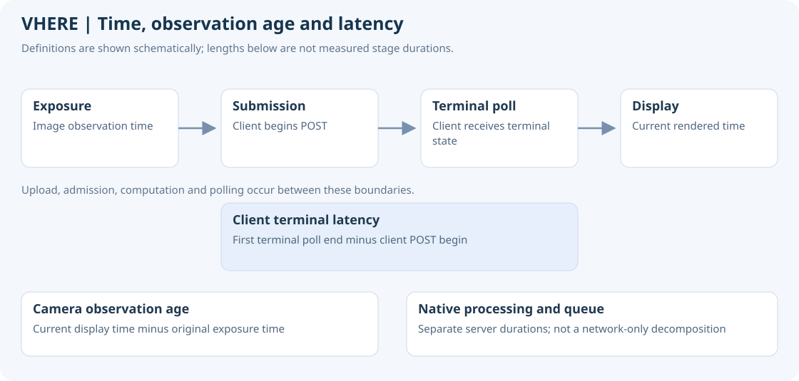

# VHERE Evaluation Definitions

Version 0.8.0-demo · October 29, 2026

[Final results](RESULTS.md) · [Method](POSITIONING-PIPELINE.md)

## Primary product measurements

Final availability is valid, unexpired final-position time divided by evaluation
time. The denominator covers the complete recording, not only successful image
requests or rendered frames. Valid stationary holding is available; an old marker
after all sources become invalid is not. Phone fallback is part of the result.
Missing final positions must remain unavailable, and their error must stay blank.

Error is horizontal Euclidean separation in a common map frame. Report final
RMSE, empirical P50/P95/maximum and large-error exposure together with availability.
Do not substitute an accepted-visual-only cohort for the product result.

## Historical recorded-route policy

The existing campus evaluation uses original frozen accepted visual predictions,
otherwise a strictly preceding recorded phone fix propagated by speed/course to
exposure. It includes all Q3=13,550 and Q4=9,644 held-out frames. Phone fix ages
remain below about one second. Output availability is time-weighted between the
first and last exposure; each observation covers the interval until the next.

This historical offline visual profile includes future window context. Its simple
visual-or-phone output policy is not the signed app's full 30-second anchor,
network-arrival and display-expiry state machine. It must be labelled as a
recorded offline reference study, not new live or final-APK field accuracy.

The map uses separate training captures. Query images do not enter the reference
library. Frozen prediction/reference audits precede this documentation rewrite.
Independent Fixed GGA observations are used only for scoring, with the archived
two-second interpolation bracket. Reference epoch counts are 4,505 / 3,218;
13,550 / 9,644 interpolated image errors are frame-weighted and correlated, not
independent GGA samples. No fitted alignment or significance claim is added.

## Timing and motion

Client transaction latency is first terminal GET response end minus POST begin
on one client clock. It retains every transaction outcome and excludes full
startup. Queue, processing and POST RTT are separate durations; overlapping
components and their medians are not additive. The remaining difference is not
a network-only measurement. Actual final output age/density require the display
and source event timeline, not just request completion times.

Speed bins use phone km/h: [0,0.54), [0.54,5), [5,15), [15,30), [30,45), [45,60).
Image-confirmed stop and turn flags are frozen diagnostics, may overlap, and are
not independent speed/yaw truth. Empty groups have no invented error quantile.
Display body/tangent alignment and render timing are not positioning accuracy.

## Next field validation

Freeze the signed APK, app/server/map identities, source validity/expiry rules
and evaluation interval before scoring the next drive. Evaluate the actual final
output state, including loss of both sources, phone fallback and reacquisition.
Use an independent reference for error. Without one, report availability and
behavior while leaving absolute accuracy unqualified. See [field-test guide](FIELD-TEST.md).
