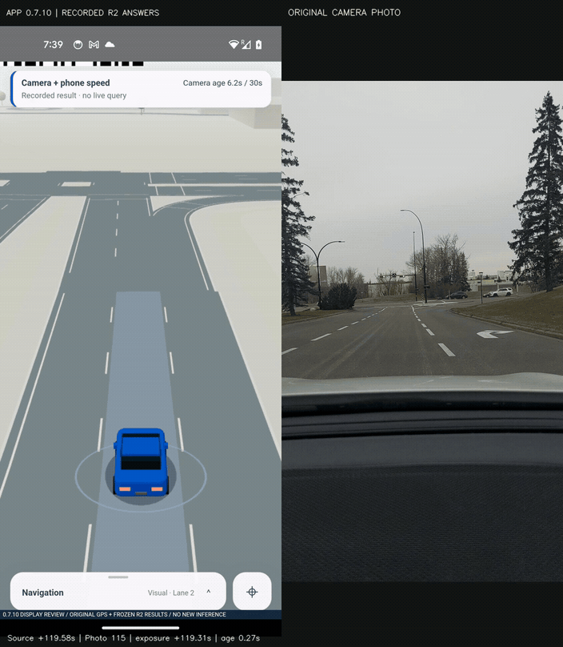
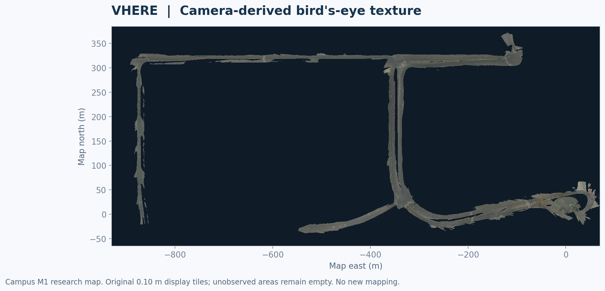
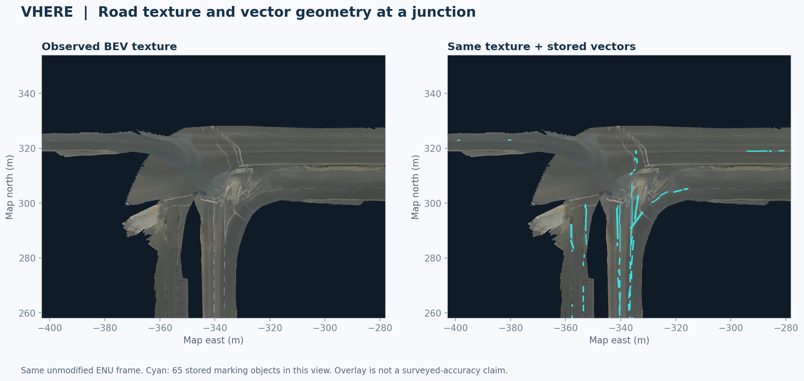
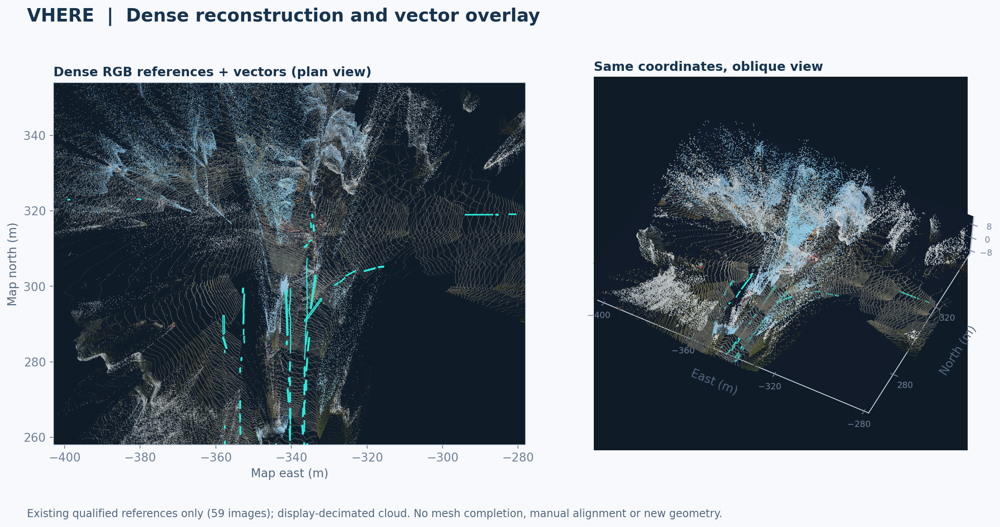

# VHERE Field Examples

Version 0.8.0-demo · October 29, 2026

[Overview](../README.md) · [Positioning workflow](POSITIONING-PIPELINE.md) · [User manual](MANUAL.md)

These examples use existing recorded observations and stored map products. They were prepared for documentation without starting a new localization or mapping run. App replay, numerical map rendering, and independent accuracy evaluation are identified separately.

## 1. Turning with the recorded camera view

Actual Pixel 5 screen capture of VHERE `0.7.10-junction-motion` is paired with the original camera photographs. The source window is approximately 119.52–131.52 seconds into the recorded session. Playback is 1×; this 12-second GIF contains 96 frames at 8 fps. Original positioning answers are replayed without new inference.

The vehicle heading follows its current road position through the turn. The recording headers and app state labels are preserved. The camera panel contains still photographs associated with their exposure times, not an invented continuous video stream.

## 2. Held motion and reacquisition

This second example covers approximately 344.54–354.54 seconds of another recorded session. Its 80 frames span 10 seconds at 1× event time. It retains a held state and an explicit reacquisition rather than presenting an unsupported correction as normal driving.

Both GIFs are resized and palette-reduced versions of actual video frames. Their 8 fps encoding is a documentation choice, not a measurement of the app's rendering rate or server latency.

## 3. Camera-derived BEV texture

The campus M1 research map combines smartphone RTK and synchronized RGB camera training captures into a georeferenced bird's-eye RGB atlas. The phone provides the mapping observations and the server constructs the map. This figure uses its stored 0.10 m display tiles. No new imagery is projected and no gaps are filled for presentation.

The wider footprint makes coverage visible: a displayed road corridor is not evidence that every surrounding area or viewpoint is supported.

## 4. Texture and vector geometry at a junction

Both panels use the same unmodified map coordinate frame. The right panel adds 65 stored marking objects in cyan. This separates observed texture from vector interpretation without replacing either layer with a schematic redraw.

## 5. Dense reconstruction with vector overlap

The colored cloud comes from 59 stored references marked ready by the existing map checks, selected around this junction. Their depth arrays are transformed with the stored scale and camera-to-map pose. Cyan vectors retain their original coordinates. Plan and oblique views show the same area.

For display, sampling uses a three-pixel step, a 70 m reference range, and one existing point per 0.08 m voxel. The crop contains 288,723 display points; the oblique view is further reduced to stay below 180,000 plotted points. These are visualization filters, not changes to the map, solver, or query workload.

The rendered cloud is not a completed watertight mesh. Holes, duplicate surfaces, and residual disagreement remain part of the recorded artifact. The map's own readiness checks are distinct from independent geometry or positioning accuracy validation.

## Provenance and reproducibility

| Item | Source and scope |
| --- | --- |
| App recordings | Pixel 5, VHERE 0.7.10, recorded phone stream and fixed positioning answers |
| Camera panel | Original field photographs, synchronized using the clock actually recorded in the app video |
| Map | Existing campus M1 research artifact; map identity begins `e981c159bd81` |
| RGB and vectors | Stored tiles and marking geometry in the map ENU frame |
| Dense references | 59 displayed references selected from the 742 marked ready in this map index |
| Processing performed here | Video-to-GIF conversion and rendering of existing map data only |
| Processing not performed here | No new inference, mapping, alignment, accuracy scoring, or deployment |

[Media manifest](../assets/media/provenance.json) records hashes, dimensions, source identity, and rendering scope. Original captures, reference arrays, full recordings, and private working paths are not distributed in this sample.

Map context in app recordings contains © OpenStreetMap contributors (ODbL 1.0) and City of Calgary data. See [third-party notices](../THIRD_PARTY_NOTICES.md). The recorded app baseline predates the signed 0.8.0 package.
