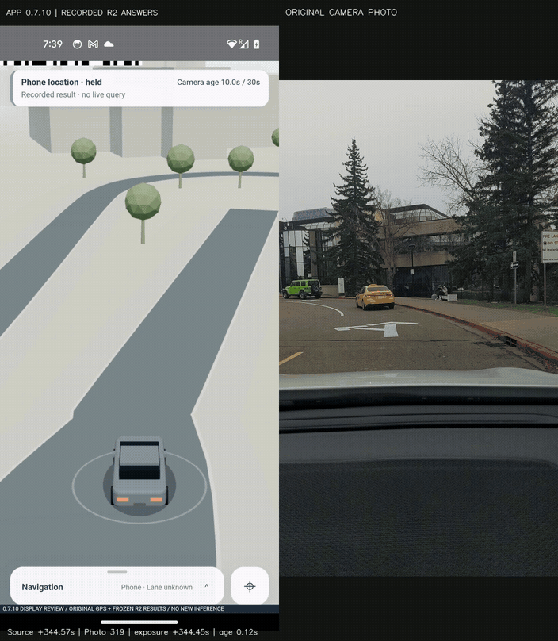

# VHERE Demo User Manual

Version 0.8.0-demo · October 29, 2026 · App `0.8.0-demo`

[Overview](../README.md) · [Positioning workflow](POSITIONING-PIPELINE.md) · [FAQ](FAQ.md)

## 1. Before you start

Use an Android 10 or newer phone with a rear camera, precise foreground location permission, and a network connection to the VHERE service. The supported test corridor is Collegiate Boulevard NW, both directions, within the prepared scene. Authorized service access is required.

Current device evidence includes Pixel 5 display checks. Other devices require separate camera, thermal, and rendering validation. The phone does not need a connected RTK receiver for normal demo use; its system location and motion observations remain part of the product workflow.

## 2. Install or update

1. Verify its version, APK SHA-256, and signing certificate information.
2. Download and install the corresponding APK using the device's normal installation process.
3. Update an existing installation with a compatible signing certificate. If signatures differ, contact the maintainer before uninstalling or clearing data.
4. Export any local records you need to preserve before changing installations.

The signed APK is in the GitHub Release. It installs as VHERE Demo (`com.vhere.demo`) alongside the older development app; its records and settings are separate. The service URL and certificate pin are prefilled; the access token is issued privately. See [service details](SERVICE.md).

## 3. Connect to VHERE

Open the bottom `Navigation` panel and choose `Connect`. A wide-screen layout also provides `Connect` in the top bar.

| Field | What to enter |
| --- | --- |
| `Server HTTPS URL` | The complete HTTPS address supplied by the demo organizer |
| `Access token (leave blank to keep)` | Your authorized token; leaving this blank when editing retains the saved token |
| `Certificate SHA-256 pin (optional)` | The organizer's certificate pin, when supplied |
| `Allow visual localization on cellular / metered data` | Whether query images may be uploaded over a metered network |

Select `Save` and check the connection state. Keep tokens out of public reports and screenshots. Resolve certificate errors by checking the service address and certificate configuration rather than disabling verification.

A successful connection establishes service access. Visual positioning also requires a compatible map, relevant references, and supported-area access.

## 4. Enable location and camera access

Grant precise location while using the app. Location supports area checks, query initialization, phone motion, and fallback.

Grant camera access when enabling the camera. Keep the view stable and avoid a large dashboard region, obstructions, strong reflections, or motion blur. Camera orientation and calibration must remain compatible with the configured setup.

The app requires valid, non-mock location observations. A stale cached position or approximate-only permission can leave it waiting. Foreground navigation and camera activity pause when the app moves to the background; this version does not provide a persistent background navigation service.

## 5. Start a visual positioning session

1. Enter a supported, mapped area.
2. Wait for phone location and scene readiness.
3. Choose `Camera` in the `Navigation` panel and follow the startup guidance.
4. Keep the app in the foreground and watch the location source and `Camera age`.
5. Review each result as accepted, rejected, failed, expired, or cancelled.

Camera startup includes focus and exposure preparation. Camera readiness, image submission, and an accepted position are separate states.

The client keeps one outstanding network localization task. Camera sampling can continue independently, but area checks, image-time location validity, service capability, backoff, and the active task determine when another image is submitted.

## 6. Understand the navigation view

### Location source and age

An accepted visual result can act as a display anchor. Available phone speed and course update that anchor toward the current display time. `Camera age` continues to show the age of the original exposure, even while the vehicle moves smoothly.

The current visual-anchor display limit is 30 seconds from exposure. This is not permission to extrapolate through 30 seconds of missing motion data: local prediction is bounded and stops on fresh zero speed, a held state, or stale motion.

A rejected new image does not erase a still-valid previous visual anchor. When visual positioning becomes unavailable or expires, the app uses a valid phone position if one exists. If neither source is valid, position availability and lane uncertainty remain explicit.

### Roads, lanes, and orientation

`Lane unknown` is a valid state: the app may identify a road without having enough evidence to distinguish adjacent lanes.

The vehicle's displayed heading follows the current road and motion state. It is not a fresh camera-orientation solution on every rendered frame. At an uncertain junction the app preserves uncertainty; an unsupported large correction uses an explicit reacquisition transition instead of an invented driving path.

Vehicle color reflects following or held/uncertain motion. Read the source text to distinguish phone and visual positioning.

### A recorded uncertainty transition

This 10-second, 1× recorded replay includes held motion and explicit position reacquisition. It preserves the actual app states while the right panel follows the original camera photographs. It illustrates display behavior using fixed positioning results, not a new live query or a claim that every observation was accepted.

### View controls

Use `Follow` to restore the tracking view. Wide-screen controls include `2D`, `3D`, overview, and display settings. Panning or rotating the scene changes the viewing perspective, not the original position estimate.

## 7. History and session records

Use `History` to inspect request states, reasons, and timing. The [results page](RESULTS.md) explains why a request can finish in about a second while accepted position updates arrive less often. Its recorded timing cohort is distinct from positioning-accuracy evaluation.

A completed task may still contain a rejected estimate.

Camera sessions can record delivered images, capture metadata, phone observations, requests/results, and navigation events, with ZIP export. Recording is subject to queue, storage, and foreground-lifecycle limits; preserve any recording error instead of assuming continuous coverage.

Inspect exported files before sharing them. Images, locations, and timestamps may identify people or places. Public reports usually need only redacted diagnostics and reproduction steps.

## 8. Stop the session

Select `Stop camera` to stop capture. Leaving the foreground pauses the relevant activity. When preserving a test session, confirm that records have been saved and exported before closing the app.

## 9. Troubleshooting

| Symptom | Check |
| --- | --- |
| Waiting for location | Precise permission, system location, outdoor reception, observation age, and mock-location status |
| Camera startup fails | Permission, another app using the camera, temperature, lighting, focus, and exposure |
| Connected, but no image is submitted | Supported area, fresh capture-time location, camera readiness, an outstanding task, or backoff |
| Visual estimate rejected | Reference coverage, viewpoint, blur, occlusion, geometry, and supporting observations |
| Network failure or timeout | Service state, network, endpoint, certificate, and metered-network setting |
| Vehicle held or lane unknown | Source, observation age, motion freshness, road ambiguity, or loss of both position sources |
| Roads are visible but visual positioning fails | Display-map coverage and visual-reference coverage are separate |

See the [FAQ](FAQ.md) for additional explanations.

## Release information and licenses

Open `Data & coverage → Release information & licenses` to read the release scope, service address and retained notices offline. See the [field-test guide](FIELD-TEST.md) before collecting a new drive.
