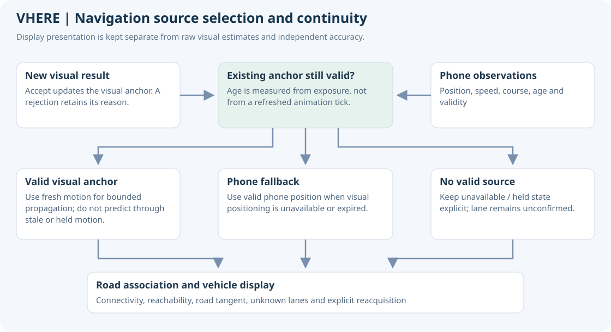
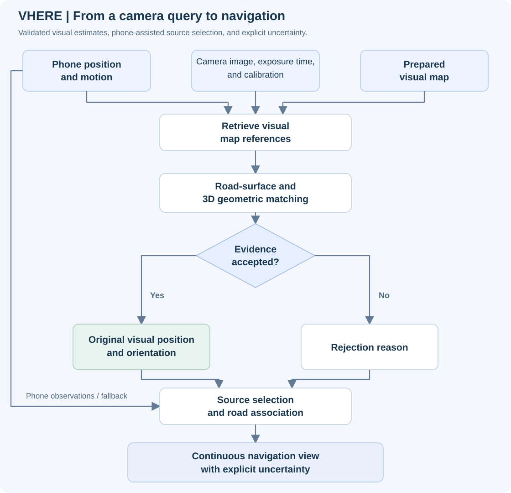
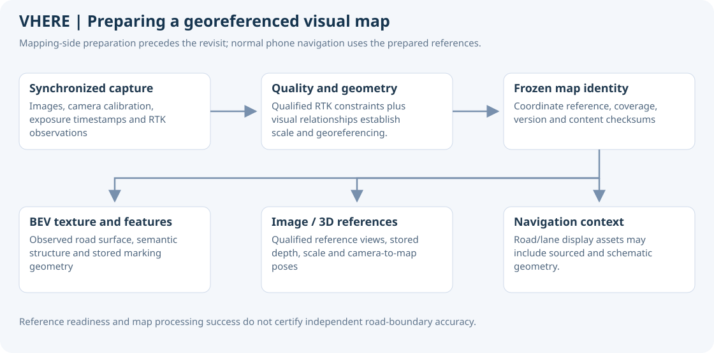
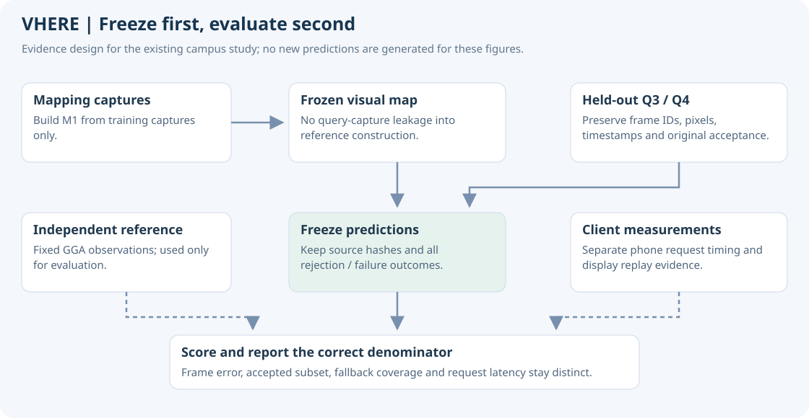

# VHERE Visual Positioning and Navigation

Version 0.8.0-demo · October 29, 2026

[Overview](../README.md) · [User manual](MANUAL.md)

VHERE estimates a camera's position within a prepared visual map and turns that estimate into a continuous road navigation view. The runtime has three distinct responsibilities: visual localization, result validation, and client-side navigation presentation.

The reference map is produced from **smartphone RTK + RGB camera capture**. The phone acquires the mapping observations, the server reconstructs the georeferenced visual map, and ordinary phones can later localize against it without RTK at query time.

## 1. Capture a current view

The phone associates a camera image with its exposure timestamp, intrinsic parameters, crop transformation, and valid phone observations. Preserving these relationships is important: a photograph belongs to its exposure time, not the time at which the server finishes processing it.

Phone location supports scene admission and reference-search initialization. Speed and course also support motion handling and fallback. Independent evaluation trajectories are kept outside the query inputs.

The client sends the observation over HTTPS with scene and map-version identity. The service owns task admission, scheduling, deadlines, and terminal states. Capture, request submission, and display rendering run at different cadences.

Observation age and measured request latency have different start and end events. Their distinction matters when the vehicle continues moving while a query is in flight.

## 2. Match the image to the visual map

The server retrieves suitable references from the fixed map. Two complementary sources of geometric evidence are used:

- **Road-surface evidence:** features and semantic structure in a bird's-eye representation help compare road markings and surface layout.
- **Image and 3D evidence:** cross-view image correspondences and qualified 3D references constrain camera position and orientation.

Candidates are checked for geometry, sufficient reference support, conflicts, and validity. Conditions requiring short-term motion support must also be satisfied. Bounded online context is different from jointly solving an entire recorded drive offline.

Models and map references may remain resident to reduce repeated loading. Each new image still receives its own query computation, and performance reports distinguish startup, activation, and warm requests.

The branches supply complementary constraints; the configured acceptance checks decide whether the available support is sufficient. They do not imply that every candidate is accepted or that a simple coordinate average is used.

### What the map evidence looks like

The same junction crop is shown with and without stored vectors. Cyan geometry represents 65 marking objects in this view; it is not a manual redraw of a complete lane network. Fragmentary coverage and imperfect alignment remain visible.

## 3. Accept an estimate or preserve its reason

When the configured checks pass, the service returns an accepted position and orientation with diagnostics. Otherwise it returns a rejection reason. Execution failure, expiration, and cancellation remain separate outcomes.

Task completion, acceptance, and independently measured accuracy are different properties. Acceptance conditions are fixed with the map and solver configuration before evaluation.

The original result remains available for diagnosis and scoring. A later display adjustment does not rewrite it.

## 4. Turn positions into navigation

The app selects an available position source, associates it with a plausible road, and updates a single displayed vehicle.

| Stage | Behavior |
| --- | --- |
| Source selection | Prefer a valid visual anchor; use a valid phone position when visual positioning is unavailable or expired |
| Motion update | Use fresh phone speed and course for bounded propagation; stop prediction when motion is stale, held, or stationary |
| Road association | Consider position, direction, connectivity, and short-term reachability rather than nearest distance alone |
| Turn animation | Follow the tangent at the vehicle's current displayed position and preserve supported lateral continuity |
| Uncertainty | Keep an unknown lane or unavailable position explicit; use reacquisition for unsupported large corrections |

A visible lane center is a presentation choice, not a new measurement. Smooth motion and road-aligned heading therefore need separate validation from the raw position and orientation estimates.

## 5. Build the reference map from smartphone RTK and camera imagery

Map preparation takes place before the revisit. **The mapping capture device is a smartphone using its RTK positioning and RGB camera.** It records synchronized images, camera calibration, exposure timestamps and RTK observations along the target roads. The smartphone supplies the measurements; computational reconstruction and map assembly run on the server.

RTK requires suitable GNSS observations and correction/reference data, so this mapping mode is different from using ordinary phone GPS fixes. Camera calibration, timing and installation assumptions remain part of the mapping configuration.

Visual relationships provide local geometry and continuity. Qualified RTK constraints establish scale and georeferencing. Time alignment, coordinate conversion, height convention, and camera mounting assumptions affect the resulting map; an RTK fixed-status label alone does not certify every observation.

The mapping process organizes the camera trajectory, road-surface feature/semantic layers, available markings or vectors, and qualified image/3D references. It records coverage, coordinate reference, map version, and content checksums. Insufficient or conflicting segments can remain unusable as localization references.

This process builds an area-specific map and reference library; it does not imply retraining a general-purpose visual model.

The existing campus M1 map merges multiple training captures. Smartphone-based acquisition is an input-provenance statement, not a claim that this map was built in one pass or that its road geometry has independently verified centimeter accuracy.

This crop uses 59 existing references marked ready by the map's own qualification checks. The RGB cloud is reconstructed from their stored depth, scale, and camera-to-map poses. Display decimation keeps the figure readable; there is no mesh completion, new inference, or manual alignment. Reference readiness is not an independent accuracy certificate.

### Localization references and display geometry

| Layer | Source | Purpose |
| --- | --- | --- |
| Georeferenced visual map and reference library | Smartphone RTK constraints and synchronized RGB imagery, reconstructed on the server | Retrieval, matching, and geometric localization |
| Road/lane and environment display assets | OpenStreetMap, City of Calgary data, and reviewed schematic geometry | Road association and an understandable navigation scene |

The display layer includes sourced external road/environment data and reviewed schematic geometry. Its full appearance is not a claim that every lane or road boundary was independently measured by the camera system. A rendered road can also extend beyond usable visual-reference coverage.

## 6. Evaluate positioning and navigation separately

Use revisit observations that were not included in map construction. Freeze predictions before comparing them with an independent reference trajectory. Evaluation references are not query inputs and must not select easier test photographs.

| Question | Measurements |
| --- | --- |
| How often is final positioning available? | Valid final-position time over the complete test, including phone fallback and explicit outages |
| How accurate is the final output? | Independent reference, all available final outputs, horizontal RMSE/P95/maximum, large errors and motion/stop/turn strata |
| How continuous is the product experience? | Valid display coverage, source proportions, observation age, wrong-road/lane events, and reacquisition |
| How responsive is it? | Startup and warm latency; upload, queue, computation, polling, and end-to-end P50/P95 including unsuccessful requests |
| How reliable is the map? | Reference coverage and registration; independent control or boundary measurements for road/lane geometry |

Use final availability and final error as the primary product results, with phone fallback included and compared against a same-time phone baseline. Keep raw visual outcomes for diagnosis. The quality of a smooth animation cannot substitute for independent positioning accuracy.

See [results and performance](RESULTS.md) for measured evidence and [evaluation definitions](EVALUATION.md) for sample and timing boundaries.
