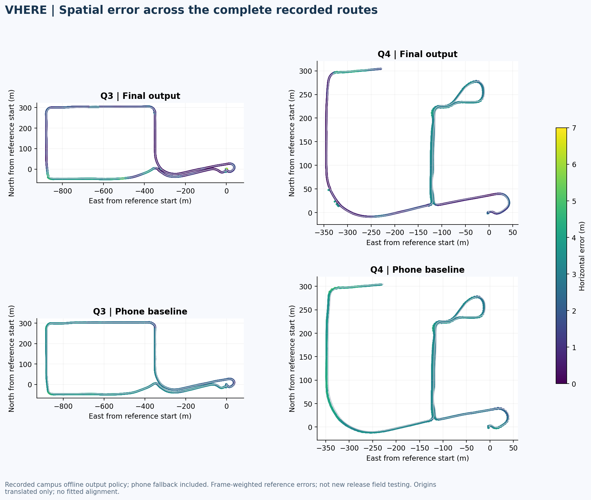
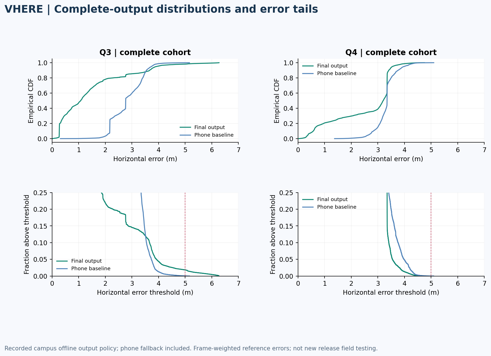
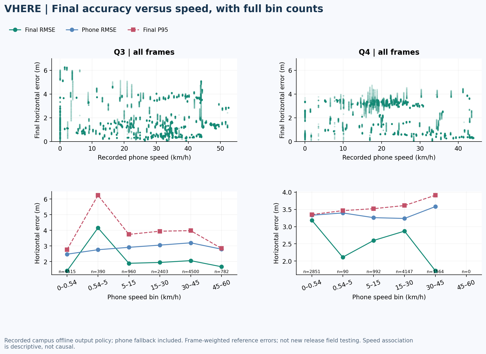
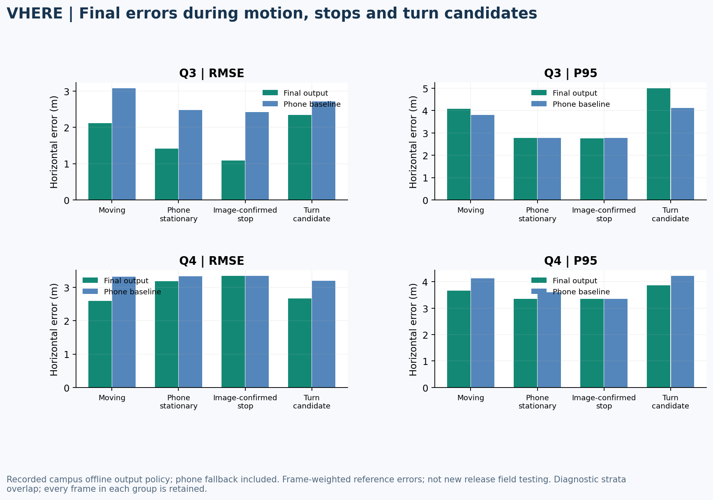
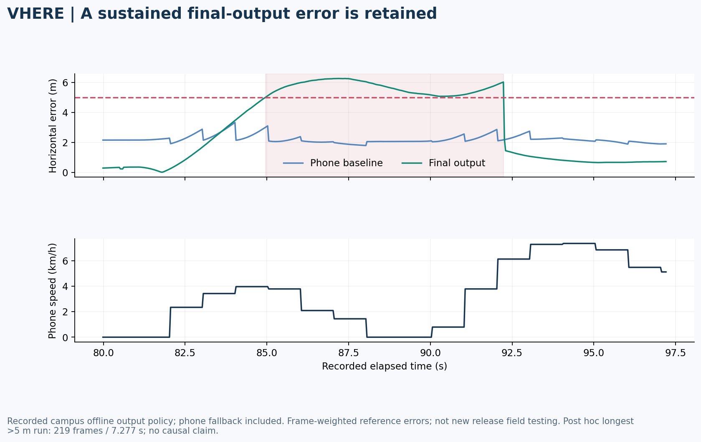
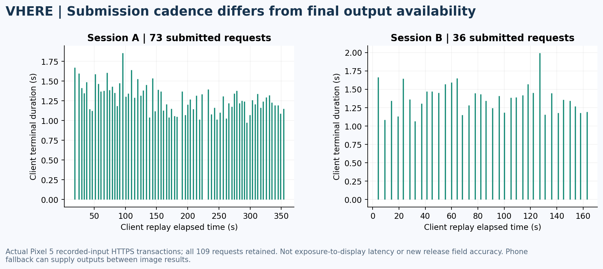
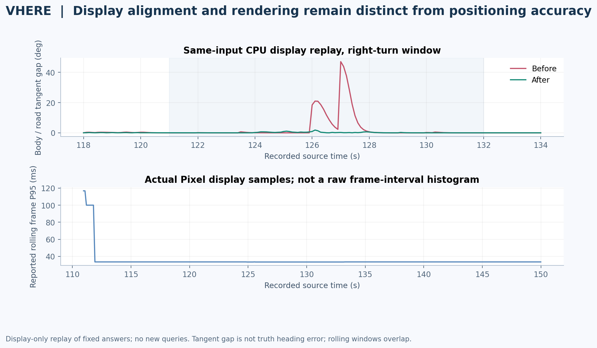

# VHERE Final Output Results and Performance

Version 0.8.0-demo · October 29, 2026

[Overview](../README.md) · [Evaluation definitions](EVALUATION.md) · [Method](POSITIONING-PIPELINE.md)

## Evidence tracks

The main positioning metrics below describe the final phone-assisted output of
the complete historical campus sequences. Original accepted visual predictions
are retained; otherwise the original preceding phone fix is propagated by its
recorded speed/course. These frozen offline results include window context and
are not a new single-photo or signed-release field benchmark.

Pixel HTTPS timing and fixed-answer display replay are separate evidence tracks.
The new 0.8.0 signed APK passed installation/startup/public-endpoint checks; its
independent outdoor accuracy remains to be measured during new field tests.

## Final availability and error

| Revisit | Duration (s) | All scored frames | Final time availability | RMSE (m) | P50 (m) | P95 (m) | Max (m) |
| --- | --- | --- | --- | --- | --- | --- | --- |
| Q3 | 451.601 | 13,550 | 100.00% | 1.913 | 1.075 | 3.921 | 6.273 |
| Q4 | 320.963 | 9,644 | 100.00% | 2.785 | 3.199 | 3.550 | 4.749 |

Availability includes phone fallback. Every frame remains in the denominator;
missing positions would remain unavailable rather than becoming zero error.
Phone positions are available throughout these recordings, which allows complete
output coverage under the stated analysis policy. This is not a guarantee for
new drives or a measure of continuous visual matching.

The archived independent evaluator interpolates 4,505 / 3,218 Fixed GGA epochs
to 13,550 / 9,644 exposure times. Errors here are frame-weighted and correlated;
the frames are not independent statistical trials.

Coordinates in the spatial panels are the original estimates with each route's
reference start translated to the origin. There is no fitted alignment, trajectory
correction or point selection for appearance.

## Comparison with phone alone

| Revisit / complete output | RMSE (m) | P95 (m) | Max (m) | >2 m frames | >5 m frames |
| --- | --- | --- | --- | --- | --- |
| Q3 / Final visual-or-phone policy | 1.913 | 3.921 | 6.273 | 2,968 | 249 |
| Q3 / Phone baseline | 2.894 | 3.730 | 5.162 | 13,103 | 6 |
| Q4 / Final visual-or-phone policy | 2.785 | 3.550 | 4.749 | 6,779 | 0 |
| Q4 / Phone baseline | 3.328 | 3.982 | 5.100 | 9,589 | 2 |

Both methods use identical frame IDs and reference times. Q3 improves RMSE but
worsens P95 and the >5 m tail. Q4 improves the listed errors, with phone fallback
supplying many outputs. Full availability by itself does not establish accuracy.

## Error versus speed and motion

Every evaluated output is included. Speed is the recorded phone speed, not an
independent surveyed speed measurement. Bin counts and empty bins are retained
in [final-speed-bins.csv](../data/evaluation/final-speed-bins.csv). These plots
describe associations among motion, viewpoint and coverage, not a causal speed
effect.

Image-confirmed stops and turn candidates are frozen diagnostic flags. Groups
overlap. The comparison uses all outputs in each group, including phone fallback;
no visually accepted subset is substituted for final-output performance.

## Persistent error

The longest Q3 >5 m episode spans 219 frames over 7.277 seconds. It is selected
post hoc for diagnosis. The time plot preserves the persistent error and the
phone baseline; it does not identify a cause such as rolling shutter or blur.

## Measured request latency

The separate Pixel recorded-input run contains 109 fresh HTTPS transactions.
All transaction outcomes remain in the timing sample. It has no independent
position reference and therefore supplies no new positioning RMSE.

| Duration | P50 (ms) | P95 (ms) | Max (ms) |
| --- | --- | --- | --- |
| POST begin to first terminal poll end | 1,316 | 1,643 | 1,992 |
| Native processing | 969 | 1,282 | 1,636 |
| Native queue | 18 | 30.8 | 61 |
| POST round trip | 254 | 345.2 | 416 |
| Client minus native processing and queue | 330 | 424.6 | 536 |

The client interval is not exposure-to-display latency. The service was ready
before this run; full model/map startup was not measured. The remainder is
unattributed overhead, not a measured network-only component. Submission RTT can
overlap processing; medians of separate distributions are not additive. This
was actual private recorded-input HTTPS processing, not a public-cellular
performance qualification of the signed release.

## Request cadence and final display

Session A submitted 73 requests with a median 4.958-second gap; B submitted 36
with a median 4.910-second gap. The service's current minimum query interval is
4 seconds. Capture frequency, requests, returned visual anchors and final display
updates are distinct. A valid phone position or bounded motion can supply the
final display between image results, so gaps between visual results are not
automatically final-position outages.

## Display continuity

The previous display baseline's same-input CPU turn replay reduces the rendered
body/road-tangent P95 gap from 20.91° to 0.85°; actual Pixel samples are about
0.64°. These are display-alignment diagnostics, not truth heading accuracy.
Overlapping rolling render P95 samples are typically 33.5 ms, with a short-window
maximum of 116.8 ms. Low-speed/joint issues and explicit reacquisition remain
known limitations; this is not a universal 60 fps result.

## Data and limits

- [Final output CSV](../data/evaluation/campus-final-output.csv): every one of the 23,194 campus frame IDs, final error, baseline error and motion flags.
- [Speed bins](../data/evaluation/final-speed-bins.csv) and [motion strata](../data/evaluation/final-motion-strata.csv): complete cohort counts.
- [Timing CSV](../data/evaluation/phone-query-timing.csv): all 109 transactions, anonymized sessions and relative times.
- [Summary and definitions](../data/evaluation/summary.json) and [figure hashes](../data/evaluation/figure-provenance.json).

No new inference, mapping, model, threshold or reference-selection change was
used to improve these results. Independently surveyed lane geometry, final-build
outdoor/cellular accuracy, cold-start distributions and calibrated uncertainty
remain separate validation work. See [field testing](FIELD-TEST.md).
